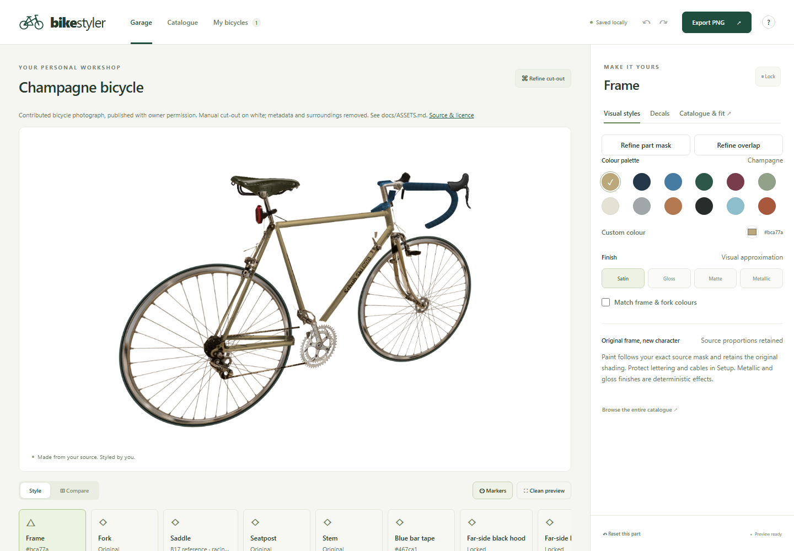
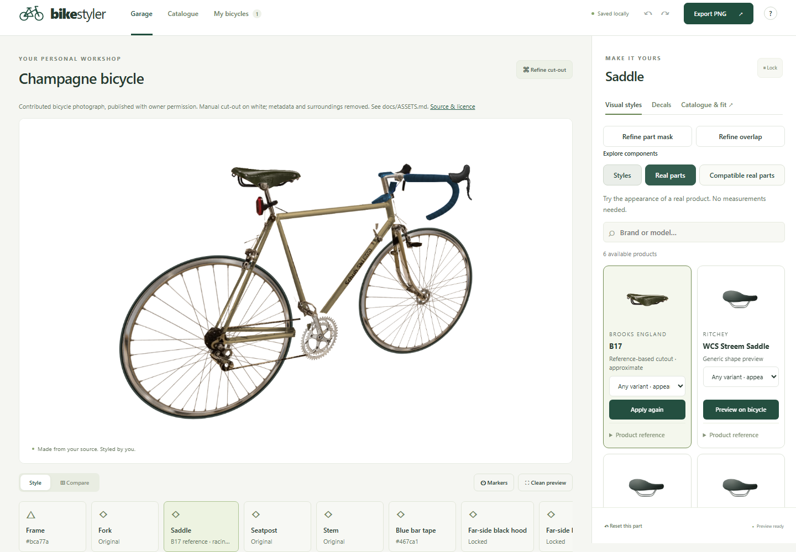
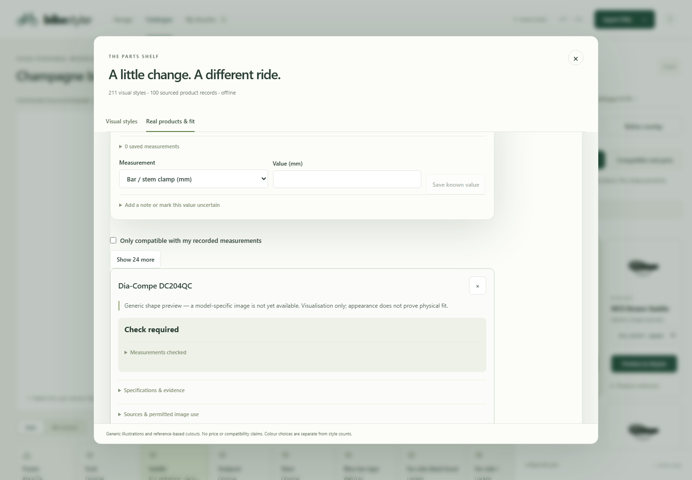
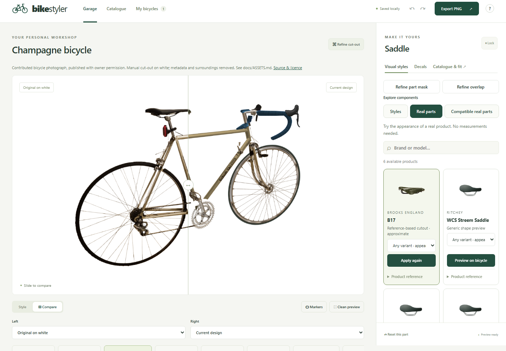

# BikeStyler

Explore how your bicycle could look, using a photograph of the bicycle you already have. BikeStyler is a local browser editor for paint, components, saved designs, before/after comparison and white-background PNG export.



[](https://github.com/nishdel/BikeStyler/actions/workflows/checks.yml)

## What you can do

- Import a bicycle photo and refine its cut-out and component masks with manual tools and classical image processing.
- Recolour surfaces while retaining photographic shading; adjust finishes, decals and individual components.
- Choose **Generic styles**, **Real parts** or **Compatible real parts** directly under **Visual styles**.
- Align replacements with rotation, scale, width, height, skew, lighting and foreground protection. Wheel placement follows the confirmed ellipse and axle.
- Save variations, compare designs, reopen portable projects and export an opaque white PNG.
- Work locally without an account, server-side processing or AI inference. Some bundled illustrations were generated during development; the app uses those static files.

**This is a visualization tool.** Appearance does not prove mechanical fit and should not be the sole basis for a purchase. “Compatible real parts” means the available, confirmed catalogue requirements match your recorded values. Unlisted interfaces and coupled systems still need independent verification. [Scope and limitations](docs/USER-GUIDE.md#catalogue-and-compatibility).

## Quick start

Install **Node.js 24.x** and Git, then:

```sh
git clone https://github.com/nishdel/BikeStyler.git
cd BikeStyler
npm ci
npm run dev
```

Open the local address printed by Vite (normally `http://127.0.0.1:5173`). Choose the practice illustration, the prepared photograph, or import your own image.

To open the bicycle shown above, use **Import portable project** and select [public/sample/champagne.bike.json](public/sample/champagne.bike.json) from your checkout. It includes masks, placements and saved variations. The original surroundings and identifying image metadata have been removed.

For the production version:

```sh
npm run build
npm run preview
```

The preview normally uses `http://127.0.0.1:4173`. Wait for **Ready offline** before disconnecting. Installation and browser-test downloads need internet initially; editing and cached production reloads do not. Keep the local preview server available for reliable reopening at the same address. Development mode does not provide the production offline cache. [Setup and offline details](docs/DEVELOPMENT.md).

## Catalogue

The bundled data currently contains **100 real product records**, **68 documented variants** and **117 unfinished research candidates**. Variants belong to product records; candidates are not verified selectable products.

There are **211 visual styles across 35 populated categories**: 207 code-defined drawings, one generic generated lever style and three generated product-reference cutout styles. The 208 generic styles are not product photographs. Four product records map to the three reference styles because the front-wheel image is reused as an approximate rear-wheel appearance. There are **zero exact manufacturer-photo previews**. Other product records use labelled generic approximations.

The wheel, saddle and crank cutouts approximate material, shape and lighting. They are not exact manufacturer photographs, dimensioned models or endorsements. [Catalogue extension](CATALOGUE.md) · [Image provenance](docs/ASSETS.md).

## A look inside







Manual correction is often necessary. A single photograph cannot reveal hidden surfaces: replacing the original crank can expose gaps, and perspective, reflections and overlaps remain approximations. [Workflow](docs/USER-GUIDE.md) · [Architecture](docs/ARCHITECTURE.md) · [Testing and limitations](docs/TESTING.md).

## Project and documentation

BikeStyler runs independently of [OmniLAB](https://github.com/nishdel/OmniLAB-Local-Agent-Bridge-) and OpenWiki. Those tools provide optional development and documentation integration; they are not runtime dependencies. Public Markdown in this repository is canonical. [Maintenance and integration](docs/MAINTENANCE.md).

Issues and focused improvements are welcome: see [Contributing](CONTRIBUTING.md). No general code licence has been selected, so this repository is **public source, not currently an open-source-licensed release**. Existing asset permissions and third-party licences remain separate. [Licensing status](docs/LICENSING.md).
