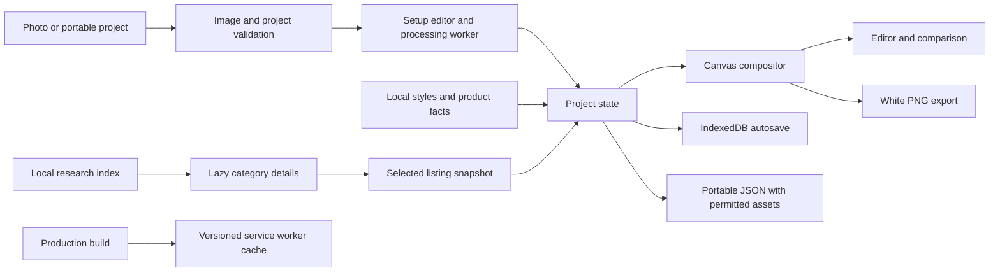

# Architecture

BikeStyler is a React/TypeScript single-page application built with Vite. All editing happens in the browser. There is no application backend.

| Area | Source |
| --- | --- |
| App state, import/export coordination | [App.tsx](../src/App.tsx) |
| Photo setup, masks and worker operations | [Setup.tsx](../src/Setup.tsx), [setup.worker.ts](../src/setup.worker.ts), [pixels.ts](../src/pixels.ts) |
| Editor, styles, comparison and placement UI | [Garage.tsx](../src/Garage.tsx) |
| Masked compositing and opaque exports | [compositor.ts](../src/compositor.ts) |
| Raster lighting and wheel projection | [rasterParts.ts](../src/rasterParts.ts) |
| Catalogue, generic geometry and reference styles | [catalogue.ts](../src/catalogue.ts), [expandedCatalogue.ts](../src/expandedCatalogue.ts), [photographicCatalogue.ts](../src/photographicCatalogue.ts) |
| Product selection and optional fit checks | [ProductVisualPicker.tsx](../src/ProductVisualPicker.tsx), [compatibility.ts](../src/compatibility.ts) |
| Validation, persistence and portable assets | [validation.ts](../src/validation.ts), [storage.ts](../src/storage.ts), [portable.ts](../src/portable.ts) |
| Production caching and CSP | [build-sw.mjs](../scripts/build-sw.mjs) |

The compositor separates source pixels, cut-out alpha, part masks and protection masks. Recolouring preserves local shading. Replacement drawing uses attachment anchors; wheel rendering accounts for ellipse and hub placement. Foreground protection retains original frame/hardware pixels where appropriate. This is two-dimensional compositing, not geometry reconstruction or a physical bicycle model.

Product metadata and visual style entries are separate. A real product may use a generic style and is labelled accordingly. Compatibility evaluates only recognized, recorded requirements. Portable projects embed selected redistributable catalogue assets so a saved design does not depend on a remote product image URL.

The research catalogue is a separate typed read model in `researchCatalogue.ts`. A small searchable index points to local category shards containing explicit variants and image-reference metadata. `ListingCard` requests details on demand; no third-party image request is made. Failed requests show Retry and are removed from the request cache. Cards are paginated, and compatibility calculations run only when requested for reviewed products.

The maintainer importer verifies a research ZIP and applies reviewed identity aliases and category corrections. App builds consume committed JSON. A selected research listing stores only a compact `ListingSelection` snapshot in the style; the renderer continues using the existing `entryId`. Validation rejects mixed product/listing selections and forged compatibility states. No new physical-fit inference or runtime model is introduced.

Phone presentation is isolated in `mobile.css`: collapsed, quick-styling and expanded browsing states share the desktop editor's project state and compositor. Visual viewport height accommodates the mobile keyboard. Applying a selection leaves expanded browsing while preserving the project, comparison and undo mechanisms.
